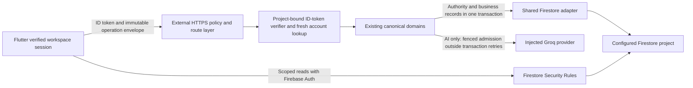

# VELORA S5.30 - Shared Firebase adapter implementation readiness plan

Date: 2026-11-11 (Asia/Kuala_Lumpur). Status: **PLANNING COMPLETE; OFFLINE IMPLEMENTATION MAY BE PROPOSED; LIVE ACTIVATION BLOCKED**.

This document is the only S5.30 file addition. It does not authorize subsequent code changes, cloud access, credential creation, configuration, deployment, migration, Git saving or billing. No implementation, tests, builds, dependency installation or network access was performed in S5.30. Existing uncommitted work is preserved. `.wrangler/` is excluded from inspection and every future manifest below.

## 1. Verified baseline and evidence boundaries

- Project: VELORA, AI Smart Inventory for cafes, bakeries, restaurants and related F&B businesses. Authentication/workspace lifecycle, Owner/Staff security, inventory, menu/recipes and Groq AI are required. Android, iOS and tablets remain targets; Chrome and physical Android are immediate acceptance platforms.
- Actual branch: `main`. Actual saved HEAD: `6cfae84dfbd9ca11ceb4a99e2585cc5d9ae97c98`. No fetch or Git mutation was performed.
- Firebase TEST: `velora-spark-test`. PRODUCTION: `velora-73222`. Spark only; no Blaze, billing or prepayment; no Cloud Functions deployment or runtime dependency in the replacement.
- S5.19-S5.27 are prior architecture/foundation milestones. S5.28 is an unsaved, unwired offline inventory transport foundation; S5.29 accepted it with conditions. S5.30 does not upgrade historical runtime evidence.
- Historical S5.28 results: Node **295 passed, 0 failed, 0 skipped**; Flutter **378 passed, 0 failed, 29 skipped**. These were not rerun here. No live Firebase, provider, physical-device or F&B acceptance follows from them.
- `docs/PROJECT_STATUS.md` and `docs/ROADMAP.md` describe the older `03e853a` baseline. Their older "not implemented" statements are not a current feature inventory. Neither document is changed here.

Source references below are repository-relative and describe the working tree at this checkpoint; unsaved files have no committed provenance yet. Line numbers are navigation aids, not permanent identifiers.

| Evidence | Actual capability and limit |
| --- | --- |
| [`functions/https/authenticated-json-http.mjs`](../../functions/https/authenticated-json-http.mjs), lines 18-118 | Injected verification, project consistency, strict routes/method/body limits, pre-domain deadlines and error normalization. No listener, real verifier/store defaults, CORS or hosting admission control. |
| [`functions/https/inventory-http.mjs`](../../functions/https/inventory-http.mjs), lines 10-37 | Four canonical inventory mutations; requires timestamp/delete capability assertions; 409 overflow; stock-only allowlisted reason. Assertions are not transform compatibility proof. |
| [`functions/https/invitation-http.mjs`](../../functions/https/invitation-http.mjs) | Create/revoke/redeem/reconcile only. Defaults preserve disabled rejoin options and injected backend clock. |
| [`lib/services/workspace_inventory_https_transport.dart`](../../lib/services/workspace_inventory_https_transport.dart), lines 149-386 | Stable request/session capture, bounded single dispatch, cleanup and uncertainty metadata. No startup/UI wiring or durable operation journal. |
| [`lib/services/workspace_session.dart`](../../lib/services/workspace_session.dart), lines 10-31; [`functions/src/mutation-episode.js`](../../functions/src/mutation-episode.js) | Client episode capture; server expectations are preconditions. Authority is independently resolved from canonical records. |
| [`functions/feasibility/shared-backend/identity.mjs`](../../functions/feasibility/shared-backend/identity.mjs), lines 8-38 | Synthetic-capable strict RS256/claims/account verifier, fixed TEST project. Injected keys/accounts; not evidence of real Google verification. |
| [`functions/feasibility/shared-backend/adapters/firebase-identity.mjs`](../../functions/feasibility/shared-backend/adapters/firebase-identity.mjs); `firebase-accounts.mjs`; `google-oauth.mjs`; `http.mjs` in that directory | Certificate/SPKI validation, rotation cache, account lookup, signed OAuth assertion and bounded HTTP prototypes. All require injection and contain TEST-specific bindings. No approved production credentials. |
| [`functions/feasibility/shared-backend/adapters/firestore-store.mjs`](../../functions/feasibility/shared-backend/adapters/firestore-store.mjs), lines 3-105; [`firestore-codec.mjs`](../../functions/feasibility/shared-backend/adapters/firestore-codec.mjs), lines 43-50 | TEST-only REST transaction prototype with buffered writes, timestamp marker and receipt observation. Missing field deletion, full query contract and compatible error provenance. |
| [`functions/src/index.js`](../../functions/src/index.js), lines 31-59 | Existing Admin-backed callable adapter illustrates `get/create/update/set`, `members` and `menuItems`. Importing it initializes Firebase; it must NOT be the external backend entrypoint. Staff removal is explicitly disabled at lines 60-64. |
| [`functions/src/workspace-invitations.js`](../../functions/src/workspace-invitations.js), lines 57-235 | Transactional Owner/issuer generation; separate redemption admission transaction; reconciliation observes receipts without restoring codes. Rejoin is opt-in internal wiring, not client flags. |
| [`functions/src/team-members.js`](../../functions/src/team-members.js), lines 62-91 | Account enrichment occurs outside transactions, followed by canonical revalidation. |
| [`functions/src/menu-service.js`](../../functions/src/menu-service.js), lines 31-100; [`functions/src/secure-groq-handler.js`](../../functions/src/secure-groq-handler.js); [`functions/src/ai-quota.js`](../../functions/src/ai-quota.js) | Existing canonical menu receipts/versions and trusted AI/quota logic are reuse targets, not absent features to rebuild. External integration is not established. |
| [`lib/services/invitation_recovery_service.dart`](../../lib/services/invitation_recovery_service.dart) | Injected compare-and-set journal foundation; no OS durability provider. Observing a receipt does not deliver an invitation secret or clear uncertainty automatically. |

## 2. Architecture decision

Keep Firebase Authentication, Firestore and Security Rules. Retire emulator workflows. Replace privileged callable transport with an external HTTPS composition that calls the existing pure canonical domains. Do not move authority into Flutter or replace scoped Firestore reads with global access.

No provider is selected or activated. Cloudflare Workers remains a candidate, subject to runtime, IAM, credentials, free-tier, privacy and cost verification. A compatible external Node host is an alternative for later review; neither is assumed permanently free. `node:crypto`, X509/SPKI, Web Crypto, ESM/CJS loading and bundling must work on the chosen runtime without importing the callable entrypoint. Existing installed Node dependencies do not establish Workers compatibility.

The first shared composition supports only existing inventory and invitation routes. Later bounded compositions add workspace, Staff, menu and AI. Route availability is an explicit trusted manifest, never a client-supplied `operation`, feature flag or environment fallback. Workspace creation and invitation redemption must remain possible for verified users who do not yet have active workspace membership; a universal pre-route membership gate would break both.

Proposed route registry (all business calls POST JSON with verified Bearer identity; no GET mutation aliases). Paths beyond the first two rows do not exist in the shared HTTPS foundation yet and are not activated by this document:

| Milestone | Exact paths | Canonical policy |
| --- | --- | --- |
| S5.34 | `/inventory/create`, `/inventory/update`, `/inventory/adjust-stock`, `/inventory/lifecycle` | Active Owner/Staff and captured actor episode; domain decides data/version/lifecycle validity. |
| S5.34 | `/staff/create`, `/staff/revoke`, `/staff/redeem`, `/staff/reconcile` | Owner for issuance/revocation/observation; verified code-bound recipient for redemption, without an existing-workspace prerequisite. |
| S5.35 | `/inventory/reconcile` | Read-only operation-specific receipt observation under canonical current authority and original operation binding. |
| S5.37 | `/workspace/create`, `/staff/list`, `/staff/remove` | Canonical verified onboarding; canonical Owner/Staff roster visibility; Owner-only removal with independent actor/target generation preconditions. |
| S5.38 | `/menu/create`, `/menu/get`, `/menu/list`, `/menu/update`, `/menu/lifecycle` | Fixed server route-to-operation map; canonical Owner mutation and Staff availability-only exception; scoped authorized reads. |
| S5.39 | `/ai/issue`, `/ai/generate` | Server-selected operation over the existing quota/admission/fencing and verified workspace contract; no client operation selector. |

`OPTIONS` is an outer HTTP-policy response for known routes only, with no token lookup or domain execution. Unknown routes/methods fail closed. Each route uses its own actual canonical field schema: in particular removal's `expectedActorGeneration`/`expectedGeneration` must not be renamed to inventory's `expectedMembershipGeneration` by a generic adapter. Uniform transport does not imply uniform business payloads.

Provider interfaces are injected factories with no network action on import and no live transport/default credential discovery. Explicit immutable project configuration must agree across verifier, account directory, OAuth principal, Firestore database and public endpoint. Offline tests bind synthetic identities to TEST. PRODUCTION bindings require a later separately approved configuration; no fallback from TEST to PRODUCTION is permitted.

## 3. Shared identity and credentials contract

### 3.1 Identity verification

`verifyIdentity(idToken) -> {uid, token: verifiedClaims}` must perform all of the following before domain dispatch:

1. Enforce bounded token/header/claim sizes. Require a supported RS256 Firebase ID-token header and a bounded `kid`; reject `none`, algorithm substitution, embedded keys and token-selected key URLs. A Firebase custom token, OAuth access token or merely decoded JWT is not an ID token.
2. Obtain public keys only from an explicitly pinned Google Secure Token certificate source through an allowlisted, bounded, redirect-rejecting HTTP client. Verify HTTPS, valid certificate dates, RSA key type/strength and signature. Preserve the prototype's SPKI-to-WebCrypto approach unless the selected runtime independently proves an equivalent implementation.
3. Cache keys no longer than the lesser of the validated HTTP cache lifetime and certificate validity. Single-flight refresh; rate-limit unknown-`kid` refresh attempts. Permit a controlled refresh for rotation, never use indefinitely stale keys. Network/cache failure fails closed; no unsigned/offline fallback.
4. Require exact configured `aud` and `iss = https://securetoken.google.com/<projectId>`, valid nonempty `sub`, safe-integer `exp`, `iat`, `auth_time`, and supported `nbf` semantics. Reject expired tokens, future issuance/authentication and malformed time ordering. Retain zero clock tolerance initially; any skew policy needs explicit tests and review. Recheck freshness after account lookup/before dispatch.
5. Require verified email. Resolve the exact UID in the same project's trusted account directory; verify matching identity/email, current email verification, disabled state and revocation cutoff. Compare `auth_time` to the normalized token-valid-after cutoff. Missing/malformed account fields or unavailable lookup deny authorization. No stale positive account cache in the initial implementation; batch lookups for roster must be bounded and validated per requested UID.
6. Do not accept client-supplied role/cafe/generation as authority. Token verification establishes identity; canonical domains transactionally establish workspace authority, including active/schema-valid mapping, member, cafe and Owner links and matching generations. Generation zero remains valid; absent generation handling must follow the existing canonical generation contract, not a new default.

The current prototypes implement much of the algorithm but pin TEST and inject synthetic dependencies. Production key-source authenticity, IAM access and account-response behavior remain unverified. Auth state and Firestore are separate systems: fresh lookup does not make account revocation atomic with a concurrent Firestore commit. Document this race; preserve Firestore membership-generation invalidation and do not claim instantaneous cross-system revocation.

### 3.2 Credential and IAM boundary

- ID tokens identify users. Separate short-lived server access tokens authorize trusted Google API access; never forward a user's ID token as privileged store credentials or expose server access tokens to Flutter.
- Preferred candidate: workload identity/federation or a provider-supported short-lived identity exchange with a dedicated, project-bound service principal. Availability, API prerequisites, trust configuration and no-billing eligibility are **UNVERIFIED / ACTIVATION BLOCKED**.
- Fallback candidate for later explicit review: injected service-account assertion signer with a rotated private key in the host's secret facility, short-lived OAuth tokens and single-flight refresh. Do not create keys or assume this fallback approved. No secrets in source, Flutter defines, web assets, logs, journals or this document.
- Initial IAM capability set: only required Firestore data transactions/queries and Firebase account lookup. Inventory lifecycle needs field updates/deletion, not document deletion. Later quota retention may require document delete; add that capability only when that milestone is approved. No project Owner/Editor, IAM administration, deployments, billing or account deletion privileges. Confirm exact permission names and API availability during separately authorized verification rather than inventing grants here.
- IAM-backed database operations must be treated as privileged and cannot rely on client Security Rules to enforce cafe isolation. Firestore IAM is not assumed to provide per-cafe authorization. Canonical path/authority validation remains mandatory even with least-privilege IAM.
- Separate TEST/PRODUCTION principals, credentials, endpoints and logs. No shared production-capable fallback principal. Fail startup if trusted bindings disagree. Identity lookup-by-email, where later needed for rejoin, is internal-only and not a public account enumeration route.

## 4. Firestore adapter contract

### 4.1 Required surface and data representation

The shared store supplies `runTransaction(async tx => result)` plus explicit transform factories `timestamp()`, `toTimestamp(Date)` and `deleteValue()`. Its advertised `capabilities.serverTimestamps` and `capabilities.deleteFields` may be true only after conformance tests pass.

| Surface | Required semantics and consumers |
| --- | --- |
| `tx.get(path)` | Exact configured database/document; returns decoded data or `null`. Validate exact returned name, transaction, types and cardinality; do not interpret malformed results as absence. |
| `tx.create(path, data)` | Buffered write with native nonexistence precondition; never an overwrite/upsert. Used by items, receipts, audits, memberships and quota records. |
| `tx.update(path, patch)` | Native existence precondition; patch only listed fields; unrelated fields preserved. No silent full-document replacement. |
| `tx.set(path, data)` | Explicit full-replacement semantics, only for audited consumers that need it; no implicit merge policy. Not necessary to activate inventory/invitations. |
| `tx.delete(path)` | Native existence policy specified/tested for the consumer. Reserved for approved quota/retention operations; not inventory or membership-removal shortcut deletion. |
| `tx.members(cafeId, limit)` | Bounded parent-scoped query for roster, preserving the canonical 101-row overflow check. No collection-group/global scan. |
| `tx.inventory(cafeId, limit)` | Bounded parent-scoped query for trusted AI snapshots, returning `{id,data}` rows. Reject oversized/malformed results instead of silently truncating input. |
| `tx.menuItems(cafeId, input)` | Exact canonical filters, document-ID ordering, cursor and `limit + 1` look-ahead. Preserve archived filtering; validate every returned row, including look-ahead. |

All read/query results must belong to the configured project/database and requested parent/path. Percent/path traversal and malformed identifiers are rejected; client payloads cannot select REST endpoints, database names or unvalidated collections. Preserve canonical legacy ID compatibility rather than introducing a quiet rename/migration.

Encode/decode plain maps, arrays, booleans, bounded strings, null, finite supported numbers and valid dates. Inventory quantities/versions/generations must remain safe integers; reject unsafe int64 values instead of rounding them. Distinguish absent fields from explicit null. Bound nesting, fields, rows and total bytes. Preserve raw Firestore transaction metadata where needed: decoded millisecond Dates are not nanosecond update-time preconditions.

### 4.2 Transactions, retries and error provenance

1. Begin a real Firestore transaction. All authority/business reads and queries use its identifier; buffer writes and forbid reads after the first staged write. Reads and native preconditions, not local memory or a process mutex, provide concurrency safety.
2. Run existing canonical callbacks unchanged. Return their result only after a validated successful commit. Validate commit time, write-result count and required transforms; malformed acknowledgement after dispatch is unknown, not success.
3. Retry the callback only after a recognized definite Firestore transaction abort that guarantees noncommit. Proposed initial budget: at most three attempts within a 20-second total transaction budget, bounded per-RPC deadlines and jittered backoff. These are proposed policy values, not a verified provider capacity limit. Exhaustion must not be disguised as an optimistic-version conflict.
4. Never retry a lost/timed-out commit, ambiguous response or already-uncertain transaction. No proxy/client replay. Keep operation keys, normalized payload, original expected cafe/generation and generated IDs stable across callback retries. Membership and optimistic-version checks rerun inside every attempt. No Groq calls, account lookup, notifications or secret delivery inside retryable callbacks.
5. Preserve a canonical exception thrown by the callback **before commit dispatch** as the original typed object. Do not wrap it into a generic store error. This retains existing HTTP domain allowlists and `insufficient-stock`. Canonical errors must not be manufactured from arbitrary Google response strings/codes.
6. Store/HTTP/decode/IAM failures use a distinct internal error provenance and phase (`precommit`, `commit-dispatched`, `acknowledged`, `unknown`). Even a store error named `permission-denied` or `aborted` must not masquerade as a canonical validation error. Transport timeout after dispatch, partial response, unknown status or lost commit acknowledgement is conservatively uncertain.
7. After a definite abort/precommit failure, attempt bounded rollback; it is cleanup, not proof about another in-flight commit. Never replace the original error with rollback failure or use rollback success to resolve a prior unknown operation. Every continuation/cancellation needs an error observer and a finite waiting budget.
8. Support transactions with no writes for authorized receipt observations. No migration, counters or repair writes may be hidden inside reconciliation.

The existing HTTP layer may conservatively return uncertain 503 for an unmapped store failure even when this particular attempt did not reach commit. Preserve that safety until an explicitly versioned error envelope is approved. A definite rejection describes an attempt, not proof that a previous same-key attempt never committed.

### 4.3 Timestamp and deletion semantics

- Inventory audit/updated/archived timestamps use a real Firestore `REQUEST_TIME` server transform, atomically with the business write. Do not substitute `Date.now()`, client time, null or literal sentinel data.
- `toTimestamp(Date)` serializes the validated canonical UTC instant. Inventory expiry remains date-only UTC as serialized by the existing Flutter models. Invitation expiry/rate windows remain the existing trusted backend clock policy; do not replace deterministic expiry dates with server-timestamp sentinels. A shared adapter must not silently change domain timestamp policy.
- Use an internal, unforgeable delete marker. In a REST patch, include the removed field in the update mask while omitting its value; never write null. Restore must remove both `archivedAt` and `archivedBy`, preserve unrelated fields/expiry/quantity and commit audit/version changes atomically.
- Reject conflicting delete/value/timestamp operations on the same field. Reject unsupported nested transform placement; make no recursive-delete or document-delete substitute. Conformance tests must inspect the actual encoded REST write, not just asserted capability flags.

### 4.4 Specific prototype gaps

| Gap | Required change before reuse |
| --- | --- |
| Fixed TEST root and endpoint allowlists | Bind all components to one explicit project/database; keep TEST isolation and require separate PRODUCTION approval. |
| No delete-field sentinel; mask derived only from encoded values | Add tested deletion mask semantics; verify restore through the shared adapter. |
| `runTransaction` catch creates `failure(error.code, ...)` at line 91 | Preserve original precommit callback exception types; separate them from store errors and uncertain commit failures. Direct reuse would turn transactional domain rejections into generic uncertain errors. |
| Retry decision keyed mainly by string `aborted` | Retry only authenticated transport-origin definite aborts, not a canonical stale-version/generation error or an uncertain error with that code. |
| No `set`/`menuItems`; only limited members/inventory queries | Implement only required, bounded consumer contracts; add cursor/filter/look-ahead tests. |
| Commit time checked only as a string; aggregate timing checked late | Validate acknowledgements, transforms and full-operation deadline behavior, including queries, credential wait, rollback and late responses. |
| Generic recovery accepts injected receipt matching | It is a primitive, not an authorized endpoint or universal recovery guarantee. Add operation-specific canonical observation. Absence remains unknown. |
| Fake REST/synthetic certificate evidence | Cannot prove real IAM, Auth, Firestore contention, routing, pricing, runtime or device compatibility. Retain prototypes as historical/test references; no deletion proposed. |

## 5. Hosting and Spark feasibility gates

No current provider pricing, quota or Firebase API eligibility was checked online. The following are requirements to verify later, not claims that Spark or a provider currently supplies them.

| Requirement | Current status / required evidence |
| --- | --- |
| Firebase Spark without Functions/Blaze | Architectural target retained. **LIVE FEASIBILITY BLOCKED pending verification** of existing Firestore database, Auth APIs, external privileged access and required service/API enablement under the actual no-billing project. |
| External host with no charge/prepayment requirement | Candidate only. Verify account eligibility, CPU/memory/request/subrequest limits, duration, egress, secret storage, concurrency, region/privacy and what happens on free quota exhaustion. Do not attach billing or promise permanent free capacity. |
| Credentials/federation | **BLOCKED for activation** until an eligible trust chain and least-privilege TEST principal are demonstrated. No credential issuance in this plan. |
| Runtime portability | **UNVERIFIED.** Demonstrate installed build tooling, ESM/CJS/domain imports, crypto and streaming support offline; later verify the selected hosted runtime. No Miniflare/workerd or emulator required/allowed here. |
| HTTPS | Exact trusted origin, valid TLS and separate project binding. No user-configurable destination, redirects, URL credentials, query-based tokens or automatic mutation retry at any layer. |
| Request/response policy | Retain per-route size limits (inventory 4,096; invitation 2,048 bytes), token cap 8,192 characters and bounded response/cleanup. Give roster/AI separately measured ceilings instead of widening every route. Bound CPU, active requests, queues, Firestore RPCs and response buffering. |
| Abuse/cost | Edge admission limits plus authenticated UID/cafe limits and existing durable quota/rate controls. An in-memory counter is not a cross-instance quota. Limit invalid-token/key-refresh traffic before expensive account/database calls. Overload denies before mutation; timeout after mutation dispatch remains unknown. |
| Logs/privacy | No Authorization headers, access tokens, private keys, invitation codes, raw bodies, AI prompts containing private inventory, emails or arbitrary exception details. Allowlisted event codes, timing and nonsecret correlation IDs with bounded retention/access. |
| Chrome | Authenticated JSON is cross-origin-preflighted unless served same-origin. Add exact allowed-origin policy, `OPTIONS` responses for known routes, allowed POST/headers and `Vary: Origin`; apply policy to error responses too. No credential cookies needed; do not combine wildcard origins with credentials. CORS is not authorization; native clients can omit Origin. |
| Android/iOS/tablets | Standards-based HTTPS with public trusted certificates, platform client redirect/cancel behavior and lifecycle handling; no cleartext exceptions or certificate-validation bypass. Test background/resume, offline loss and process death on physical devices. |
| Deployed Rules/indexes | Repository drafts are not deployment evidence. Verify actual TEST isolation and later approved PRODUCTION protections; no Rules change/deployment authorized here. |

If a candidate requires Blaze, billing attachment, paid API access, a deposit, or credentials/IAM that are unavailable under the constraints, mark **that candidate BLOCKED**. Do not relax the constraint. Later alternatives are another eligible external free-tier host/identity path, a separately reviewed approved signer/credential mechanism, or continued offline operation with privileged features disabled. An alternative is not permission to perform cloud operations. Lack of feasibility evidence is unresolved, not proof that every Spark architecture is impossible.

## 6. Durable uncertain-outcome recovery

### 6.1 Operation state model

Use a durable local journal keyed by `(projectId, uid, operationType, stableKey)` with original cafe, actor generation, item/target context, expected version, canonical payload digest and schema version. Persist an atomic `prepared` record and receive storage acknowledgement **before** dispatch. Persist only the minimum nonsecret recovery context; never persist ID tokens, server credentials, invitation codes or Groq secrets. If nonsecret payload fields are needed to reproduce the canonical digest, specify them explicitly and protect their local privacy.

Proposed states: `prepared -> dispatched/unknown -> acknowledged`, or originating definite rejection when no earlier uncertainty exists. A prepared record surviving a crash is treated as possibly dispatched, not as safe-to-resend. CAS/single-writer enforcement must prevent two tabs/isolate/processes racing to issue an operation; an in-memory lock or Preferences read-then-write is insufficient.

- Never refresh expected workspace/generation/version to make an old request succeed. Never generate a replacement key to escape uncertainty. Never automatically replay mutation POSTs at startup, reconnect, token refresh, proxy retry or page reconstruction.
- A later definite rejection does not erase an earlier possible commit. Keep both attempt-level outcome and operation-level unresolved history. A revoked/removed/different-session account may be unable to observe old results; remain blocked/unknown rather than leak prior workspace data.
- Reconciliation is an explicit authenticated read-only operation with canonical current authority and original episode/payload matching. It may report `committed`, `unknown` or safe unavailability/conflict; it cannot authorize a new mutation or claim that receipt absence proves noncommit.
- A committed historical result is not current stock or membership state. Reload scoped data independently when needed. Replay must never reapply stock, remove a newer Staff episode or reconstruct an invitation secret.

### 6.2 Existing evidence available to inventory recovery

| Operation | Authoritative records to validate in one read transaction |
| --- | --- |
| Create | Deterministic item ID/hash; item's immutable creation request/payload hash and creator; linked initial-stock movement and creation activity. Current mutable quantity/name is not the original creation payload. |
| Metadata update | `inventory_update_<requestHash>` activity, actor/item/request/payload hash, stored updated/no-op result and version. |
| Stock | `stock_<requestHash>` movement plus `inventory_stock_<requestHash>` activity; matching actor/item/payload, arithmetic/result/version, schema and original episode binding. No single unlinked record is sufficient. |
| Lifecycle | `inventory_lifecycle_<requestHash>` activity; actor/item/payload, requested transition, original result/version. |

The new read-only domain must reuse existing `mutationEpisode`, generation validation and exported input normalizers. Request hashes/digests must exactly match canonical normalization/order; test equivalence against records actually produced by each mutation, including update field sorting and dates. Do not invent a second client authorization policy or permit receipt/path selection by clients. Use canonical records/Owner links inside the same observation transaction. No writes or schema backfill is necessary for the initial observational foundation; if existing records lack sufficient evidence, return unknown.

Staff has heterogeneous semantics. Invitation creation rejects duplicate requests instead of returning a saved secret; reconciliation cannot restore code delivery. Redemption first commits a rate/admission transaction and then attempts membership creation. A definite membership rejection does not mean no admission-counter write occurred. Unknown admission must not trigger blind replay or membership success. Rejoin/removal receipts carry separate actor/target generations and historical-result semantics. Recovery must be operation-specific, not a generic "all non-200 means nothing changed" rule.

### 6.3 Durability blocker

The existing invitation journal has only injected persistence. `shared_preferences` is installed, but installation is not evidence of atomic durable CAS across tabs/processes or crash-safe dispatch journaling. Browser IndexedDB transactions and platform-native durable transactional storage are candidates, not implemented providers. No new dependency installation or privileged client Firestore writes is authorized. Platform storage selection/implementation needs its own bounded manifest before wiring. Until durability and session rebinding after restart are demonstrated, recovery/client activation is **BLOCKED** even if pure journal tests pass.

## 7. S5.29 acknowledgement corrections (next implementation)

**S5.31 objective:** close only the two medium findings. **MODIFY exactly** `lib/services/workspace_inventory_https_transport.dart` and `test/workspace_inventory_https_transport_test.dart`; ADD/DELETE none. No models, domain, UI/startup, configuration or payload changes.

1. Creation acknowledgement: canonical creation currently emits `item_` plus 64 lowercase hexadecimal characters (`inventory-create.js:202`) for first success and replay. Validate this create-specific schema; reject empty/whitespace, padded IDs, dot/dot-dot, separators, controls, wrong prefix/length/case/nonhex and wrong types. Do not apply the new creation format restriction to existing update/stock/lifecycle request IDs: compatible legacy IDs may be valid in those domains. Do not pretend a shape check proves the returned digest belongs to this operation; exact derived-ID correlation, if added, must use the canonical normalized key/UID/cafe hash and receive separate explicit scope approval if another dependency is necessary.
2. Stock-in acknowledgement: in addition to existing exact direction/quantity, safe integer/version and boolean checks, require resulting quantity at least the positive requested addition. Test zero/below-addition, negative, fractional/unsafe values and wrong types. Both `adjusted: true` and canonical replay `adjusted: false` must accept valid historical arithmetic. Stock-out may legitimately result in zero; no current-item comparison may reject a valid historical replay.
3. Preserve existing malformed-response classification as uncertain after dispatch, typed UI failures, no automatic retries, UTC payloads, fingerprints and captured session context. Replace synthetic create-success IDs in fixtures with canonical-format IDs; keep at least one Node-generated reference fixture for cross-language compatibility without running live services.

Offline verification: targeted new Dart tests plus existing four inventory-service, episode and relevant widget regressions using cached dependencies and `--no-pub`; focused analysis/format checks; whitespace/scope checks. No tests are run in this planning milestone. Acceptance: both gaps closed, replay and legacy-ID compatibility assertions pass, no application import/wiring changes. Rollback: leave adapter unwired; use reviewed scoped patch reversal only after later authorization, never Git reset/cleanup. Database/billing: none.

## 8. Ordered implementation manifest

The following are **proposed exact allowlists**, not execution approval. Paths marked ADD are proposed new files; MODIFY applies only when a prior dependency has created the file. DELETE none throughout. No implicit package/config/runtime/provider changes. If implementation needs another path or installed dependency, stop that milestone and revise its allowlist for approval. All offline commands must list intended tests explicitly; never run emulator/integration package scripts. Each milestone records actual commands/results and preserves unrelated unsaved work.

### S5.31 - Acknowledgement hardening

Exact two-file scope, dependencies, tests, acceptance and rollback are specified in section 7. This is the recommended next implementation. It need not wait for hosting decisions.

### S5.32 - Shared identity, credential and outbound HTTP foundation

**ADD:**
- `functions/backend/google-http.mjs`
- `functions/backend/google-oauth.mjs`
- `functions/backend/firebase-identity.mjs`
- `functions/backend/backend-errors.mjs`
- `functions/test/shared-google-http.test.mjs`
- `functions/test/shared-google-oauth.test.mjs`
- `functions/test/shared-firebase-identity.test.mjs`

**MODIFY:** none. **Dependencies:** this contract; cached Node tooling only. Provider/federation selection is not required to test injected signing and synthetic accounts, but is required for later live use.

**Contract:** explicit TEST-bound configuration, bounded injected transport and signer, separate identity/account/OAuth failures, safe key rotation and fresh account checks; no import-time I/O, secrets/default SDK initialization, public account enumeration, live endpoint activation or production fallback. Batch UID lookup and internally scoped email lookup may be factory capabilities for Staff, never standalone public routes. Reuse tested algorithms from feasibility references while removing hidden hardcoded cross-component assumptions; keep the references unchanged.

**Offline verification/acceptance:** Node syntax checks; generated in-memory RSA/X509 fixtures; wrong signature/project/issuer/UID/time/email; expired/rotated/unknown keys, refresh stampedes, disabled/revoked/malformed/missing accounts, stale lookup completion, timeout/redirect/size limits, concurrent OAuth refresh, malformed token responses and sanitized failures. No token accepted after failed verification; no actual HTTP transport is instantiated by tests. Cross-project account/credential destinations must be rejected. **Rollback:** do not import new factories into application wiring; retain original foundations. **Database/billing:** no live impact; later account/OAuth requests consume service quotas and remain gated.

### S5.33 - Shared transactional store and transform compatibility

**ADD:**
- `functions/backend/firestore-codec.mjs`
- `functions/backend/firestore-store.mjs`
- `functions/test/shared-firestore-codec.test.mjs`
- `functions/test/shared-firestore-store.test.mjs`
- `functions/test/helpers/shared-firestore-rest-fake.cjs`

**MODIFY:** none. **Dependencies:** S5.32 outbound HTTP/error contract. **Contract:** section 4, including query surfaces needed by Staff/menu/AI; no cloud defaults. Capability assertions only after encoding/transaction tests pass.

**Offline verification/acceptance:** independent scripted REST fake checks exact paths/transaction IDs, existence preconditions, patch masks, server transforms and actual deleted-field encoding; all reads before writes; schema-safe codec; native definite abort retries with changed membership/version between attempts; no retry for canonical stale errors or unknown/applied-but-lost commits; preserved callback error identity; query isolation/filter/cursor/look-ahead and overflow; read-only transaction behavior; credential/deadline/rollback and malformed commit cases. Tests must use the new store, not only the existing in-memory domain stores. **Rollback:** leave new store uncomposed; no migration. **Database/billing:** none offline; real transaction RPC volume and indexes are later feasibility gates.

### S5.34 - Compose inventory/invitations through the shared adapter and HTTP policy

**ADD:**
- `functions/backend/application.mjs`
- `functions/backend/http-policy.mjs`
- `functions/test/shared-application.test.mjs`
- `functions/test/shared-http-policy.test.mjs`

**MODIFY:** none. **Dependencies:** S5.31-S5.33. **Contract:** inject the real-contract adapter factories into existing `createInventoryHttp`/`createInvitationHttp`; retain their exact route/error/body contracts and opt-in feature defaults. Outer policy adds exact-origin CORS and preflight, admission limits and no-store errors without changing canonical authorization. No listener/deployable credentials or production configuration.

**Offline verification/acceptance:** one synthetic identity-to-REST-to-domain path for every inventory/invitation route, both Owner and Staff where permitted, generation zero/nonzero, outsider/cross-cafe/stale binding denial, duplicate keys, audit integrity, archive/restore actual encoded deletes, definite overflow/reason preservation, callback retries and unknown commits. Invitation status/shape snapshots must remain identical. Simulate allowed/disallowed/null/missing origins and preflight without token/mutation; ordinary POST still requires identity. **Rollback:** keep composition unused; retain existing active UI/services. **Database/billing:** none offline; real route activation remains blocked.

### S5.35 - Read-only inventory recovery domain and route

**ADD:**
- `functions/src/inventory-recovery.js`
- `functions/test/inventory-recovery.test.js`

**MODIFY:**
- `functions/https/inventory-http.mjs`
- `functions/test/inventory-http.test.mjs`
- `functions/backend/application.mjs`
- `functions/test/shared-application.test.mjs`

**Dependencies:** S5.33-S5.34. **Contract:** one explicitly allowlisted `POST /inventory/reconcile` observation route; strict operation-specific envelope and original operation context/digest. Reuse canonical normalizers and membership-generation validation, checking the same mapping/member/cafe/Owner records; no new authority claims or arbitrary receipt paths. Cross-domain agreement tests must reject every invalid authority fixture accepted by none of the mutation domains. Return only validated historical result metadata, not arbitrary stored documents. No mutation, repair, code delivery or receipt deletion.

**Offline verification/acceptance:** all four operations produce records through canonical mutations using the new store, then recover through the observer; no-write assertions; missing/partial/forged/conflicting receipts stay unknown/unavailable; unrelated actors/workspaces/generations denied; absent receipt plus late commit remains unknown then observable; later current stock/version does not overwrite historical acknowledgement. No existing receipt migration. **Rollback:** remove route from future route manifest; keep observer unused and evidence intact. **Database/billing:** no live impact; future reconciliation consumes reads, never write/backfill privileges.

### S5.36 - Durable mutation journal and inventory recovery client foundation

**ADD:**
- `lib/services/mutation_recovery_service.dart`
- `test/mutation_recovery_service_test.dart`

**MODIFY:**
- `lib/services/workspace_inventory_https_transport.dart`
- `test/workspace_inventory_https_transport_test.dart`

**Dependencies:** S5.31, S5.35; reviewed section 6 journal state model. **Contract:** injected persistence with atomic durable prepare/CAS contract; original-key/context preservation; operation-level uncertainty survives later definite failures; explicit read-only reconciliation. Remain unwired; do not claim a fake persistence implementation is durable. Preserve existing invitation journal behavior and secret-delivery restrictions, rather than replacing it casually with a generic journal.

**Offline verification/acceptance:** fake durable restart/reconstruction, conflicting tabs/CAS, storage failure before dispatch (zero sends), write acknowledgement lost, unknown then later definite rejection, sign-out/back and cafe/generation changes, absent receipt and late commit, read-only recovery versus blind replay, cleanup/deadlines and zero automatic mutation retries. Reject unavailable/corrupt storage. **Rollback:** keep adapter unused; never clear pending records to roll back. **Database/billing:** none; no privileged client database writes. Platform persistence and Chrome/native process-death proof remain activation blockers.

### S5.37 - Workspace and Staff HTTPS domain coverage

**ADD:**
- `functions/https/workspace-http.mjs`
- `functions/https/staff-http.mjs`
- `functions/test/workspace-http.test.mjs`
- `functions/test/staff-http.test.mjs`

**MODIFY:**
- `functions/https/invitation-http.mjs`
- `functions/test/invitation-http.test.mjs`
- `functions/backend/application.mjs`
- `functions/test/shared-application.test.mjs`

**Dependencies:** S5.32-S5.35. **Contract:** explicit canonical workspace-create, roster and removal routes; fresh verified account lookup; roster batch account reads outside transactions followed by canonical revalidation. Workspace ID generated once outside retry callbacks; use existing onboarding semantics rather than forcing existing membership. Removal actor/target generations, no self/Owner removal, tombstones, immutable audits and historical replay are preserved. Trusted rejoin options/account resolution may be injected into invitation composition for offline tests only; default remains disabled and clients cannot choose flags or target generations. No change to callable disabled flags in `src/index.js`.

**Offline verification/acceptance:** onboarding without workspace, invalid email/ownership, duplicate workspace attempts; Owner roster versus Staff self/Owner visibility; concurrent removal/rejoin, actor generation changes, replay unable to remove a later episode; issuer-generation independent of target-generation binding; stale invitation revocation still possible; no account-lookup data leakage. Use the shared REST adapter, not just preexisting pure-domain fakes. **Rollback:** new routes remain unavailable to the application; trusted features default disabled; preserve membership evidence. **Database/billing:** no live operations; later membership/receipt/audit writes require explicit acceptance, no automatic migration or backfill.

### S5.38 - Menu HTTPS domain coverage

**ADD:**
- `functions/https/menu-http.mjs`
- `functions/test/menu-http.test.mjs`

**MODIFY:**
- `functions/backend/application.mjs`
- `functions/test/shared-application.test.mjs`

**Dependencies:** S5.33 query support and S5.34 composition. **Contract:** explicit create/get/list/update/lifecycle routes over `menuOperation`; preserve Owner-only mutation policy and canonical Staff availability-only exception, receipt conflicts, prices/currency, optimistic versions and archived visibility. Reads remain authorized and scoped. No recipe/stock-consumption side effects.

**Offline verification/acceptance:** canonical `menu-service.test.js` regressions plus shared-store mutation/replay, stale/cross-cafe/Staff field-forgery rejection, query cursor/filter/look-ahead isolation and malformed rows. **Rollback:** leave menu routes unwired; preserve existing data/receipts. **Database/billing:** none offline; real index/query/read/write feasibility remains a gate.

### S5.39 - Secure Groq and quota HTTPS coverage

**ADD:**
- `functions/https/ai-http.mjs`
- `functions/test/ai-http.test.mjs`

**MODIFY:**
- `functions/backend/application.mjs`
- `functions/test/shared-application.test.mjs`

**Dependencies:** S5.32-S5.34 and proven inventory query/delete semantics. **Contract:** route-selected issue/generate invokes `createSecureGroqHandler` and existing `createAiQuota`, not a new authorization/quota system. Secrets/provider/account transport are injected; no live Groq calls. Preserve payload digest, lease/fencing, durable limits, canonical membership before/after provider work, bounded validated output and no provider I/O in retryable Firestore callbacks. Never release a quota claim on an uncertain provider dispatch merely to allow retry. No public cleanup, arbitrary-model, arbitrary URL or quota-reset endpoint.

**Offline verification/acceptance:** existing secure Groq/quota regressions plus shared-store scripted paths for admission contention, quota exhaustion, stale generation, prompt/output validation, provider timeout/lost result, session invalidation, fencing and no duplicate provider dispatch; fake provider only. **Rollback:** AI routes disabled/unwired; retain quota evidence and pending tickets. **Database/billing:** none offline; actual Firebase/provider quotas and Groq terms/free-tier eligibility remain BLOCKED until verified. Saved recipes, recipe/menu linkage and atomic Cook Now are separate required follow-on contracts, not implicitly implemented by generation routes.

### S5.40 - Platform durability and activation preparation record

**ADD:**
- `docs/architecture/shared-backend-activation-gates.md`

**MODIFY:** none. **Dependencies:** preceding backend foundations, a candidate host and an explicit later authorization for any external verification. **Objective:** collect evidence for the gates below and produce exact runtime/deployment/client-wiring/platform-persistence manifests after provider/storage choices are known. This is a release handoff, not another invitation-only code audit or permission to deploy.

**Contract/offline verification:** reconcile route coverage against all privileged callers, document verified versus unknown capability/cost/IAM facts, select eligible durable platform storage and derive bounded implementation scopes without assuming `shared_preferences` supplies CAS. Record runtime compatibility and safe rollout/disable criteria. **Acceptance:** no gate labeled passed without its direct evidence; in the current no-network/no-device milestone, live gates necessarily stay BLOCKED/NOT TESTED. **Rollback:** leave integrations disabled and retain the evidence record. **Database/billing:** none; any later TEST data creation must be separately authorized and enumerated, with no resets, cleanup or production migration implied.

## 9. Activation acceptance gates and rollout safety

Offline milestone completion is not permission to activate even a TEST endpoint. Live verification is a separate authorized activity and is not performed here. Required evidence:

1. An eligible external host and credential/IAM path under Spark/no-billing constraints; dated quotas/limits and failure behavior verified against authoritative provider material/account state. No billing or Blaze workaround.
2. Real Firebase TEST ID-token signature/project/time verification and fresh account disable/revocation checks. Wrong-project identities never reach domain dispatch. No PRODUCTION credential use during TEST acceptance.
3. Real Firestore TEST transaction/read isolation, native create/update preconditions, definite abort retries, unknown commit observation, server timestamps and deletion of both archive fields. Include actual contention and linked audit integrity; synthetic simulation is insufficient.
4. Reviewed actual Rules/indexes, project/endpoint/principal bindings, origin allowlist, secret handling, least privilege and no automatic mutation retry at host/proxy/client layers. No global-data fallback.
5. Durable platform journal plus atomic prepare/CAS, crash/restart recovery and safe session transitions. Pending uncertainty persists across reconnect/logout and later definite rejection; no invisible replacement operation.
6. Explicit UI/startup wiring manifests and transport selection for inventory, onboarding, Staff, menu and AI; no silent callable fallback. Account lifecycle, recipe saving and Cook Now require their own scoped contracts/receipts before enabling them. No new privileged Flutter writes are an acceptable shortcut.
7. Chrome preflight/TLS/redirect/error behavior; physical Android network loss, stale session, process death and recovery; APK build/install acceptance with recorded project/endpoint. Physical iOS/tablet acceptance remains required for claims about those platforms; no emulator/simulator substitute.
8. F&B UAT: Owner onboarding, Staff invitation/removal/rejoin, inventory create/edit/in/out/history/archive/restore, menu availability/recipes, AI quota/error behavior, reconnect/uncertain operations and stock-consumption consistency. Test cafe/bakery/restaurant flows and relevant tablet layouts; document defects and unresolved states, not just successful screenshots.

Rollout order after separate approval: isolated TEST backend qualification -> TEST client opt-in with real devices -> F&B UAT -> separately approved PRODUCTION binding and rollout. Disable mutation routes and client controls on regression; do not switch an uncertain operation to another backend or replay it with a new key. Preserve receipts, tombstones, quota fences and journals. No destructive rollback, automatic backfill or deletion of old directories is proposed. A future data migration needs a separate plan, explicit approval and evidence of schema compatibility.

## 10. Master progress and decision

| Workstream | Current evidence / remaining gate |
| --- | --- |
| S5.28 inventory HTTPS foundation | Historical offline tests passed; unwired/unsaved; two acknowledgement corrections pending S5.31. |
| S5.29 acceptance | PASS WITH CONDITIONS; no production activation accepted. |
| S5.30 | This implementation-ready contract and bounded sequence; no runtime implementation or live feasibility certification. |
| Shared identity/store | TEST-only prototypes and injected foundations exist. S5.32-S5.34 must establish compatible shared adapters and composed offline coverage. |
| Inventory | Canonical mutations/history/scoped reads exist; S5.31, real-store proof, durable recovery, controlled wiring and device acceptance remain. |
| Workspace/Staff | Canonical provisioning/invitation/roster/removal/rejoin logic exists; external coverage, policy-controlled activation, durability and device invalidation acceptance remain. |
| Menu/recipes | Canonical menu domain exists; shared query/HTTPS/client integration, recipe linkage and UAT remain; do not rebuild existing policy. |
| AI | Existing secure Groq/quota library exists; shared runtime/secret/provider integration, real quotas, saved recipes and authorized audited consumption remain. No live AI readiness claimed. |
| Account lifecycle | Inventory/Staff adapter completion does not establish safe account deletion, workspace closure or transfer; enumerate remaining callers and define separate authorization/recovery/retention contracts. |
| Hosting/device/UAT | Unverified/blocked until the specific live/platform gates pass. No overall production completion percentage is justified. |

**Decision:** GO for proposing S5.31's exact two-file offline correction, followed by shared identity/store implementation. **NO-GO for live activation.** Firebase Spark/Auth/Firestore/Rules remain; external HTTPS is the privileged replacement direction; Cloudflare remains a candidate. No Cloud Functions deployment, emulator workflow, Blaze, billing or prepayment is introduced.

**S5.30 impact:** one new unsaved architecture document; database unchanged; billing unchanged; application/backend/tests/configuration unchanged; Git unstaged/uncommitted/unpushed. Subsequent milestones and any external verification require their own explicit authorized scope.
